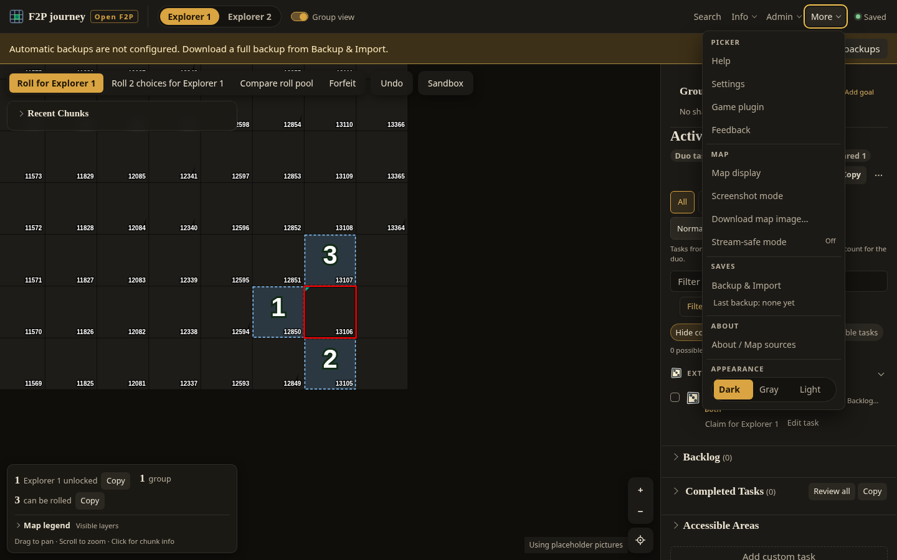
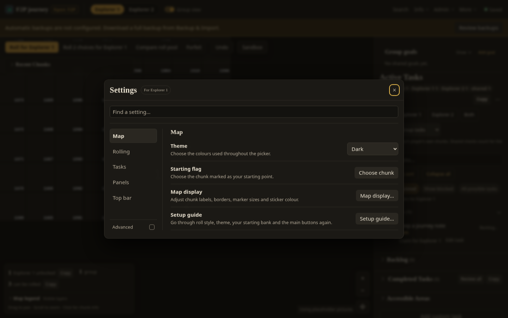
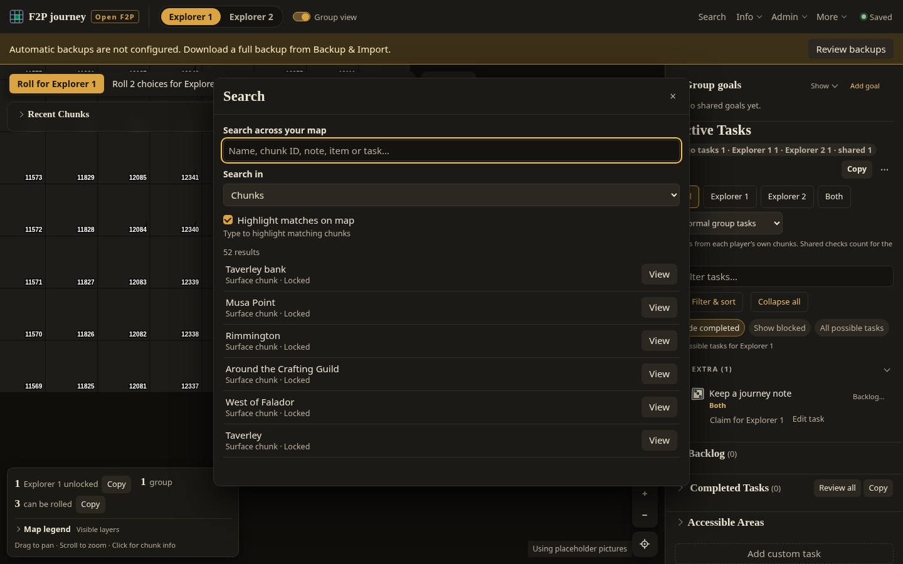
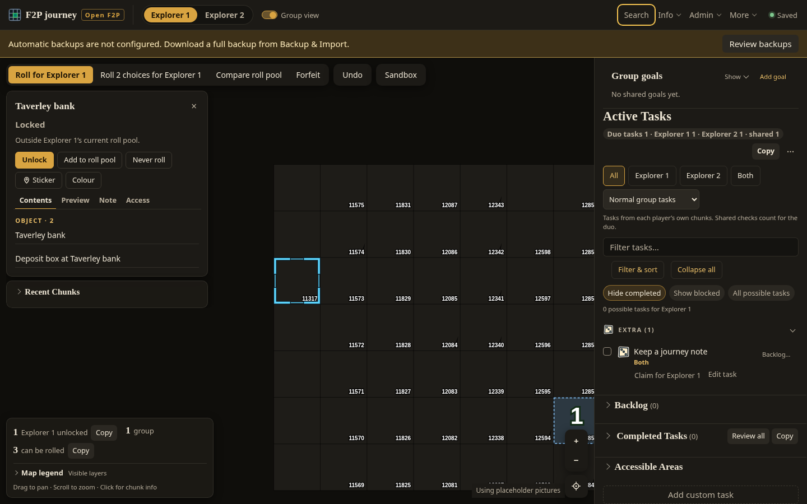
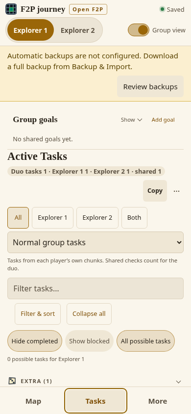
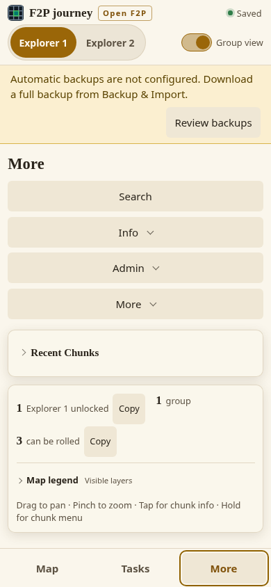
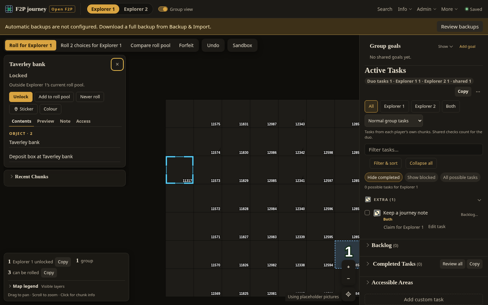
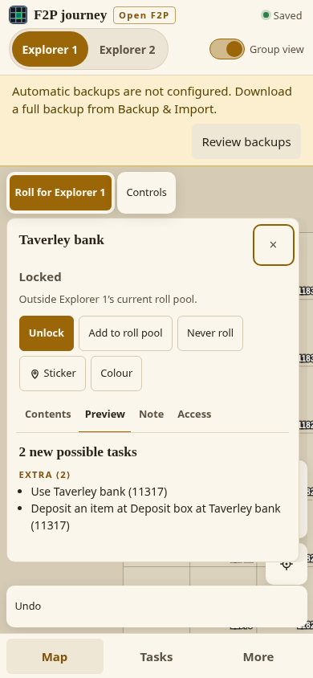

# Web client accessibility check — 2026-10-25

START: `90dcb2aaf181e036dfd9dacf9807ecf59d9720cd`.

## Scope and method

Report written from the initial browser check before making app changes.
Playwright Core 1.56.1 and axe-core 4.11.0 run on this VM. Chromium
154.0.8037.57; final verification uses Node 24.20.0 (initial exploration used
24.19.0). The audit started October 25 UTC and verification continued October 26. Only the public
`open-f2p` dataset and a newly created disposable save were used. No existing
saves or external game assets were fetched. Desktop 1440×900 and phone 390×844;
dark and light appearances; keyboard Tab/Shift+Tab, Enter, Space, arrow keys,
Home/End and Escape. Screenshots below are from this run and were opened and
inspected. Axe is instrumentation only (CSP bypass in the test context).

This checks browser semantics, not actual speech output from NVDA, JAWS or
VoiceOver. It does not certify WCAG compliance. Other palettes and private-only
surfaces were not exercised. Public synthetic fixtures in the screen suites
cover additional render paths.

## Findings by surface

| Step / surface | Severity | Evidence and initial result | Disposition |
| --- | --- | --- | --- |
| 1. Topbar / More tools | Pass | Native buttons and details/summary (no div-based buttons or unnamed icon actions found in tested surfaces); named icon controls; visible 2px keyboard focus. Tab reaches More, Enter opens, Escape closes and returns to its summary. | Retain existing behavior. |
| 2. Settings | Pass | Native modal keeps background controls inert during Tab navigation, opens on Close, has a named title and labeled controls. Escape returns to the closed More summary. Both dark/light axe checks have no violations. | Retain existing lifecycle. |
| 3. Search | Moderate | Labeled search and mode fields, live result count; intentionally modeless so the map remains usable. Every result action is named only “View.” | **Fixed:** contextual accessible names, with visible wording retained. |
| 4. Search → Chunk Info | Serious | Activating a result opens the panel but focus returns to topbar Search, far from the requested details. Arrow/Home/End navigation and tab/tabpanel semantics already work once reached. Escape from the panel returns to the map canvas. | **Fixed:** dialog close hands focus to Chunk Info’s Close button on desktop and phone, without changing panel rendering. |
| 5. Tasks / Possible Tasks | Serious (existing) | Search, filter controls and All possible tasks are keyboard operable and labeled; count has status semantics. Completed Tasks nests Review all and Copy buttons in its summary; axe reports `nested-interactive` on desktop and phone. Some screen readers suppress descendants of disclosure controls. | Needs a design decision: put actions beside the disclosure or inside its expanded content. Either changes layout/availability and is outside this patch. |
| 6. Phone Tasks / More | Pass | Map/Tasks/More expose tab roles, selected state, controls and tabpanel labels. Left/Right moves focus and selection; only the selected tab is in the Tab sequence. Tools remain reachable through phone More. | Retain existing responsive navigation. |
| Save / errors / Calculating | Moderate | Saved already has role=status; task engine and calculation feedback also have live status semantics. The shared error notice has the same polite status role as ordinary notices. | **Fixed:** errors are alerts, ordinary notices remain status, save/notice messages explicitly atomic. Keep request failure handling untouched. |
| Contrast | Pass in sampled themes | No axe text contrast failures in the checked dark/light surfaces. Focus is visible in screenshots. Numeric contrast measurements recorded below after verification. | No colour changes needed. Map focus over varied terrain still needs broader asset coverage. |
| Reduced motion | Moderate | Dialog entrance and screenshot hint already opt out; disclosure rotation, switch sliding and checkbox transforms retain transitions under reduce. | **Fixed:** CSS animation/transition disabled under prefers-reduced-motion: reduce. The existing JavaScript roll reveal also already checks this preference. |
| Headings | Minor | Main heading, section headings and dialog titles are present. Chunk content groups use h4 under the h2 panel heading. | Follow-up: choose consistent heading levels across tab content and nested groups. No visual/layout change in this patch. |

## Initial evidence

1. Topbar / More, dark: keyboard focus ring and native disclosure.
   
2. Settings, dark: visible focus on Close inside the modal.
   
3. Search, dark: labeled fields and repeated View actions.
   
4. Search result opened: focus incorrectly remains on topbar Search.
   
5. Phone Tasks, light: selected Tasks tab and visible ring.
   
6. Phone More, light: tools moved into the More view; tab focus visible.
   

## Verification

### Files changed

- `app/web/index.html`: explicit atomic save and notice status messages.
- `app/web/screen-ui.mjs`: shared error notices use alert semantics; ordinary notices keep status semantics.
- `app/web/screen-dialogs.mjs`: optional close destination, guarded by dialog generation; existing opener/fallback behavior retained.
- `app/web/screen-search.mjs`: result-specific accessible names and close destination for chunk results.
- `app/web/style.css`: reduced-motion override for decorative transitions/animations and smooth scrolling.
- `tests/accessibility-focus.test.mjs`: destination focus, stale close protection and subsequent opener restoration.
- `tests/web-browser.test.mjs`: shipped Search result semantics/destination and shared error/status behavior.
- `scripts/perf/accessibility-browser.mjs`: repeatable keyboard/semantics/contrast checks with external scratch dependencies; unexpected axe findings fail the run. The one existing Completed Tasks finding is reported explicitly.
- This report and eight inspected screenshots.

No shared screen-context fields or new test files were introduced. The existing
classified screen and focus test files contain the regressions. No loading-panel renderers,
request failure handling, layout, colours, changelog or roadmap were changed.

### Browser results and measurements

The final check uses three fresh-context pairs in order **before/after,
after/before, before/after**. “Before” serves the five changed client resources
from a copy of START’s `app/web`; all other resources and the server are shared.
Every run uses the same public synthetic save. Themes are selected through the
real controls; checks wait for colour transitions and dialog entrance to settle.
All external browser requests are blocked. This is functional measurement, not a
performance benchmark.

| Measurement | Before, three runs | After, three runs | Median before → after | Spread (min–max) |
| --- | --- | --- | --- | --- |
| Passed keyboard/semantics checks (out of 22) | 17, 17, 17 | 22, 22, 22 | 17 → 22 | 17–17 → 22–22 |
| Failed checks | 5, 5, 5 | 0, 0, 0 | 5 → 0 | 5–5 → 0–0 |
| Reduced-motion disclosure transition | 150, 150, 150 ms | 0, 0, 0 ms | 150 → 0 ms | 150–150 → 0–0 ms |
| Unexpected axe findings / page errors | 0, 0, 0 | 0, 0, 0 | 0 → 0 | 0–0 in both |

The five improved assertions are contextual result names, desktop result focus,
explicit atomic save semantics, reduced-motion transitions, and phone result
focus. All other assertions retain their passing behavior. Across all three after
runs: **66 passed assertions / 0 failed**. Each run checked nine axe surfaces;
only `#completed-details > summary` retains `nested-interactive` on views that
include the task sidebar. No text contrast violations remain after settling.

Contrast was unchanged in every before/after run (min–max spread zero):

| Theme | Body text / panel | Muted text / panel | Minimum focus / bg, panel, surface |
| --- | ---: | ---: | ---: |
| Dark | 13.74:1 | 8.01:1 | 9.02:1 |
| Light | 14.24:1 | 7.09:1 | 4.32:1 |

These are computed opaque theme-token ratios. Axe additionally checks rendered
text in the tested surfaces. Canvas terrain can vary; these ratios do not prove
focus contrast against every possible map image. Peak memory was not sampled;
this patch makes no allocation or speed claim.

The 22 browser checks cover More keyboard open/Escape, visible focus, native
modal state and keyboard containment, Settings return, Search labels/results,
Chunk Info handoff and tab keys, panel Escape, task search/Possible Tasks, filter
Escape, save status semantics, reduced motion, phone navigation and phone result
focus. Chromium briefly focuses the document at a native modal wrap stop; the
next Tab reenters the dialog and background controls remain inert. This is browser
behavior, not a custom focus trap.

Separate keyboard checks exercised Settings → Rolling, Tasks, Panels, Top bar,
Find a setting, Backup & Import and Add custom task; no axe violations in those
modal states. Escape with a populated native search input first clears the query;
a subsequent Escape closes Settings. Search remains intentionally modeless;
changing that interaction needs a design decision. Saved is readable as a live
status, not an extra keyboard stop. Existing save-recovery buttons remain native
controls; no request-failure behavior was changed.

### Test results

| Command / check | Passed | Failed | Skipped | Result |
| --- | ---: | ---: | ---: | --- |
| Focused screen/focus tests (`node --test tests/accessibility-focus.test.mjs tests/web-browser.test.mjs`) | 310 | 0 | 0 | Pass |
| `npm run test:quick`, Node 24.20, 271 files | 2,314 | 0 | 65 | Pass; 106.8 s |
| `npm test`, Node 24.20, 612 files, direct invocation | 5,346 | 1 | 137 | Failed: container orphan reaping; 433.1 s |
| `python3 /workspace/.tools/run-reaped.py npm test`, Node 24.20, 612 files | 5,347 | 0 | 137 | Pass; 418.6 s |
| Worker lifecycle file with supplied reaper | 8 | 0 | 0 | Pass; unchanged test/application code |
| Final browser assertions, three after runs | 66 | 0 | 0 | Pass |

Initial Node 24.19 exploration hit the existing native coverage-event mismatch
in `ci-coverage-reporter.test.mjs`: its isolated run was 4 pass / 1 fail. The
same unchanged file passes 5 / 0 on the preinstalled Node 24.20. Final required
suites use 24.20; no test-runner code was changed.

The direct full run’s one failure was `process-worker.test.mjs` → “an owned
calculator exits when its parent disappears without calling terminate.” It
reproduces in isolation (7 pass / 1 fail) because this container’s PID 1 retains
orphan zombies, so `kill(pid, 0)` still sees an exited child. The setup supplied
`/workspace/.tools/run-reaped.py` specifically for this host condition. The
unchanged lifecycle file passes 8 / 0 under that wrapper; the full suite passes
under the same wrapper. The wrapper uses Linux child-subreaper semantics and does
not skip tests or change application code.

### Fixed focus evidence

7. Desktop, dark: Search result now focuses Chunk Info’s Close button.
   
8. Phone, light: opening a Search result selects Map and focuses the visible panel.
   

### Remaining risks / design decisions

- **Completed Tasks:** separate Review all / Copy from the disclosure summary while retaining discoverability and phone targets. This is the remaining serious axe finding, not a regression from this patch.
- Choose consistent heading levels in Chunk Info groups and decide whether modeless Search should offer stronger guidance for returning to map/panel content.
- Verify announcement timing and navigation with NVDA/Firefox, JAWS/Chrome and VoiceOver/Safari, including mobile screen readers. Browser roles and axe cannot establish actual speech behavior.
- Broaden contrast checks to real terrain and other palettes; the public dataset uses placeholder map pictures.

Recommendation for this scoped patch: **MERGE-CANDIDATE**. Both required suites
pass with the runtime setup described above. This is not an accessibility
compliance sign-off.
